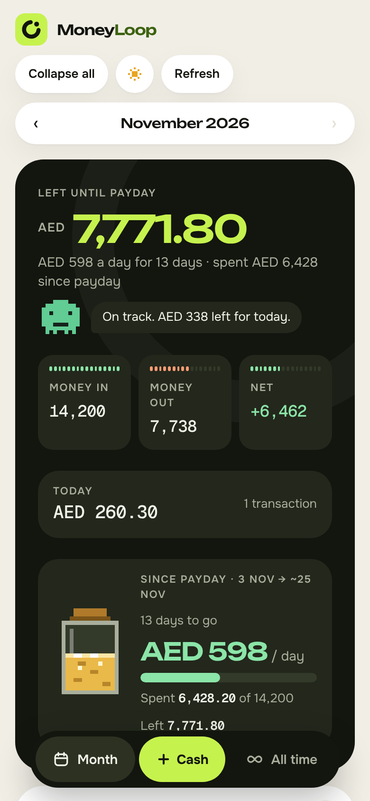
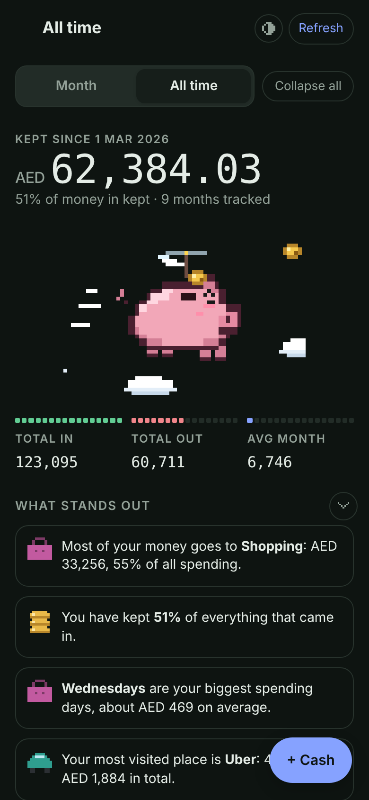
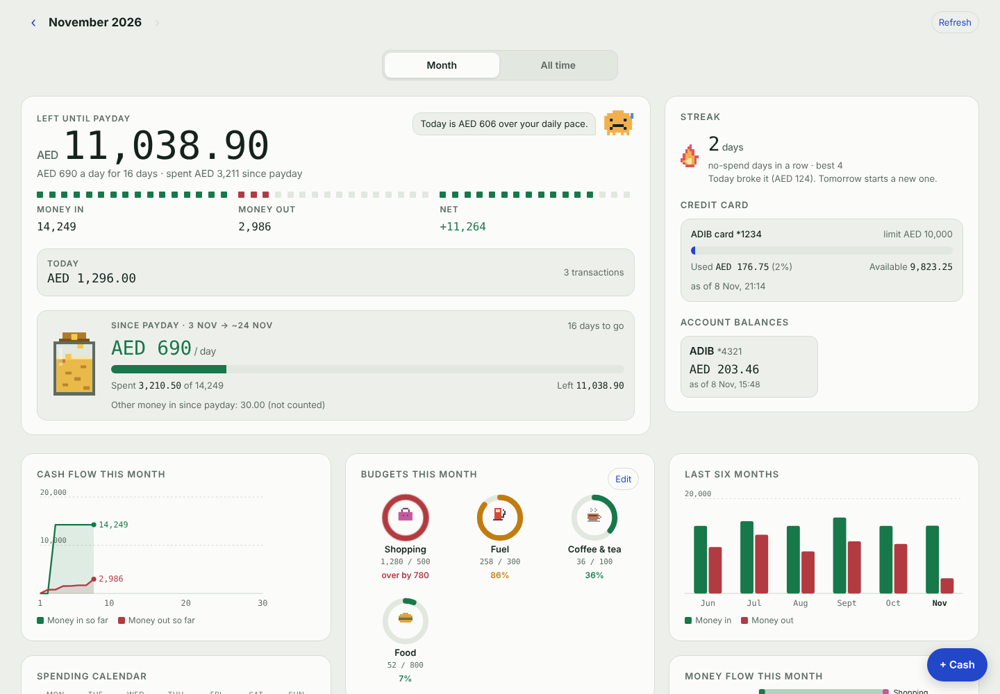
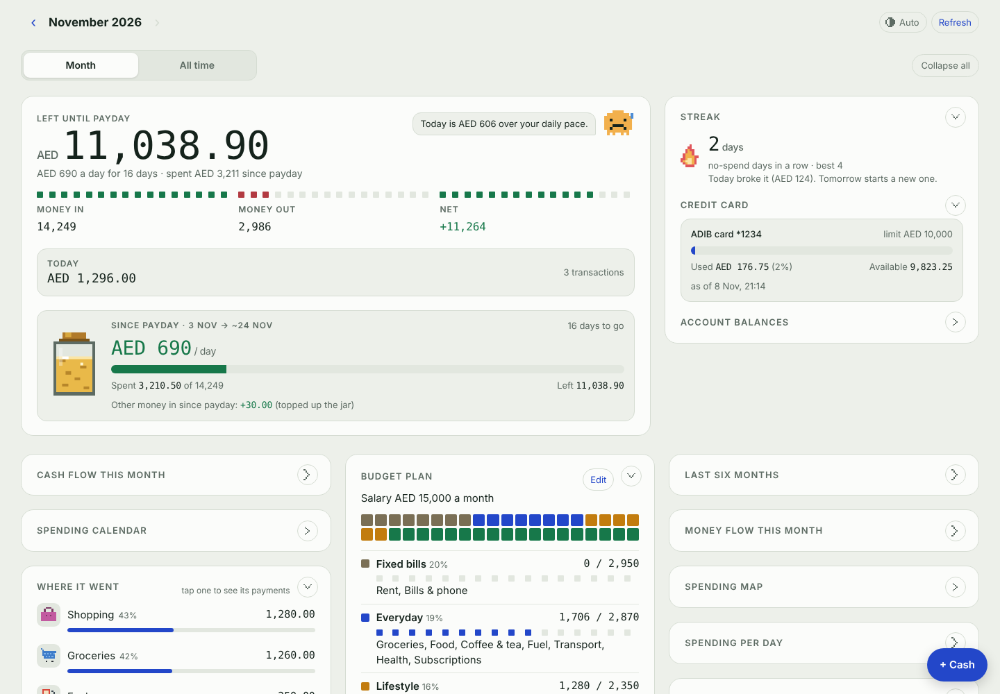

# My Money

A personal money dashboard for iPhone that fills itself in. Every bank SMS and every Apple Pay tap is sent to your own Google Sheet, and a pixel-styled dashboard shows where your money went, what is left until payday, and how your savings grow over time.

No app to install, no bank logins, no servers to run. It is a Google Sheet, a small Google Apps Script, and three iPhone Shortcuts automations — all inside your own accounts.

<p align="center">
  
  
</p>

<p align="center"></p>
<p align="center"></p>

> Screenshots use made-up sample data.

## What it does

**Captures money automatically**
- Reads bank transaction SMS the moment they arrive (purchases, transfers, salary, money from friends, refunds, ATM cash).
- Records Apple Pay taps from Wallet, including where you paid, and merges them with the bank SMS for the same payment so nothing is counted twice.
- Recognises transfers between your own accounts and credit-card bill payments and leaves them out of income and spending.
- Tracks credit cards against their limits (used / available).
- Cleans up names: `AANI Transfer, FAB SARA AHMED KHAN` becomes **Sara Ahmed Khan** under *From people*.
- Sorts payments into categories (Rent, Groceries, Food, Coffee & tea, Fuel, Transport, Bills…) and learns when you correct one.
- Messages it can't read go to a *Review* tab instead of being lost. One-time passwords and declined payments are ignored.

**Month view**
- **Left until payday** (salary-to-salary) with a daily allowance, or *Spent this month* before your salary lands.
- **Budget plan**: your salary split into fixed bills, everyday, lifestyle and savings as a pixel strip, with what you have spent in each group and whether you are on track to save.
- Pixel buddy that reacts to how today is going, a no-spend streak flame, and a **pay jar** that fills with every bit of money that comes in (salary, transfers, refunds, cash) and drains as you spend.
- Budget rings per category, spending calendar heatmap (tap a day), cash-flow chart, animated money-flow diagram, spending map of Apple Pay payments, six-month trend.
- Tap a category to filter, search any transaction, tap a row to recategorise or mark it as an own transfer, add cash by hand.

**All time view**
- A **mood piggy bank** drawn frame by frame: when more went out than came in, a cracked piggy runs from simulated pixel flames while coins leak out; when you kept more, it flies with a propeller while coins drop into its slot.
- Savings mountain: a pixel landscape that grows with your running savings — bare brown earth, green pines, then sakura in bloom as your savings rate rises.
- Month-by-month table and chart, cash flow since you started, spending mix by month, category leaderboard, income by source, people you send to and receive from, weekday and time-of-day patterns, a year in pixels, top places, biggest payments, and plain-language insights.

**Notifications and reports**
- A 10 pm daily summary notification on your phone.
- A monthly report emailed to your Gmail on the 1st, plus an *Overview* tab with charts inside the sheet.

**Looks right everywhere**
- Phone, tablet and laptop layouts, and reduced motion respected.
- **Light / dark switch**: one tap flips between light and dark, remembered on each device (the first visit follows your phone).
- Every panel can be **collapsed or expanded**, with *Collapse all*; less-used panels start collapsed and your choices are remembered.

## How it works

```
 Bank SMS ──► iPhone "Message" automation ──┐
                                            ├──► Google Apps Script web app ──► Google Sheet (your data)
 Apple Pay ─► iPhone "Wallet" automation ───┘            │
                                                         ├──► Dashboard (web page, your secret link)
 10 pm ─────► iPhone "Time of Day" automation ◄── summary│
 1st of month ───────────────────────────────────────────└──► Monthly email to you
```

iPhones don't let other apps read notifications, so the trick is to have your banks send **SMS** alerts (most UAE banks let you choose SMS or app notifications) and use Shortcuts automations, which *can* read SMS and Wallet taps.

## Get started

1. **[Setup guide](docs/SETUP.md)** — Google Sheet, script, deployment and the dashboard link (about 15 minutes).
2. **[iPhone Shortcuts](docs/IPHONE-SHORTCUTS.md)** — the SMS, Wallet and daily-summary automations, and adding the dashboard to your Home Screen.
3. **[Customising](docs/CUSTOMISING.md)** — your names, cards, payday, budgets, categories, other banks and currencies.
4. **[Troubleshooting](docs/TROUBLESHOOTING.md)** — the problems people actually hit, and how to fix them.

## Requirements

- An iPhone with the Shortcuts app (iOS 17 or newer recommended).
- A Google account (free).
- Banks that can send transaction alerts by SMS. The reader understands common UAE formats (ADIB, Al Hilal, ADCB and similar wording used by FAB, Emirates NBD, Mashreq and others) and can be extended — see [Customising](docs/CUSTOMISING.md#adding-a-bank-or-message-format).

## Privacy and security

- **Your data stays in your Google account.** The script runs as you and writes only to your own sheet. Nothing is sent anywhere else.
- **One secret key protects everything.** The web app is reachable by your phone, so every request must carry your key. Use a long random key, never share your dashboard link, and change the key if a link leaks (see [Setup](docs/SETUP.md#changing-your-key)).
- **No bank passwords or card numbers are ever used.** Only the text of alerts you already receive, and only the last digits of a card as written by your bank.
- The repository contains no personal data. Do not commit your own copy of `Code.gs` once you have put your key in it.

## Project layout

```
src/Code.gs          Google Apps Script: web app, sheet logic, overview tab, monthly email
src/Dashboard.html   The dashboard page (HTML, CSS and JS in one file)
src/parser.js        The SMS reader on its own, for testing (same code as in Code.gs)
tests/               node tests/parser.test.js — sample messages only
docs/                Guides and screenshots
```

## Contributing

Bank message formats change and every bank writes them differently. If a message from your bank isn't understood, open an issue with the message **with your name, account numbers and balances replaced by fake ones**, or send a pull request that adds a pattern to `parseMessage` and a test to `tests/parser.test.js`.

## Licence

MIT — see [LICENSE](LICENSE). This is a personal tracking tool, not financial advice, and it is not affiliated with any bank or with Apple or Google.
